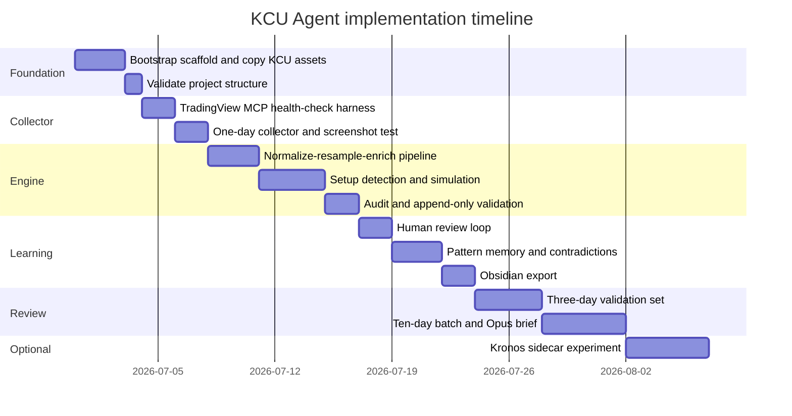

# Future-Proof KCU Backtesting Agent Architecture

## Executive summary

The strongest version of this project is a **split-brain architecture**: TradingView MCP acts as the chart-side collector and screenshot operator, Python acts as the deterministic backtesting engine and audit layer, an Ollama cloud model handles **low-cost tagging or code-adjacent labeling**, Claude Opus handles only **compressed, high-value reasoning**, Kronos remains an **optional forecasting sidecar**, and Obsidian becomes the human-readable mind vault rather than the source of truth. This design is future-proof because each layer can be swapped independently: the collector can later move from TradingView MCP to a licensed historical data provider, the tagging worker can move between Ollama cloud or local models, and the reasoning layer can move between Opus versions without breaking the file contracts. citeturn10view2turn10view4turn12view2turn15search0turn6view8turn6view3turn6view4turn6view6

The largest architectural risk is **not technical** but **policy and data-governance related**. The TradingView MCP repo explicitly warns that it uses undocumented internal TradingView Desktop APIs through Chrome DevTools Protocol and can break after TradingView updates; it also warns that programmatic consumption of TradingView data may conflict with TradingView’s Terms. TradingView’s published policies state that market data is licensed for display-only use and explicitly prohibit non-display usage and machine-driven processing that does not involve direct human-readable display. If your pipeline exports raw candle data or derived data to cloud models, you also move beyond the repo’s “all data stays on your machine” local-only posture. The clean mitigation is to treat TradingView MCP as a **research collector for personal/local workflows only**, pin the TradingView Desktop version, keep raw extraction local by default, and plan a migration path to a licensed historical provider for scaled 30–90 day research. citeturn10view1turn9view0turn13search0

The second major gap is with the **Ollama cloud tagging worker**. Ollama Cloud can run supported cloud models through the same API style as local Ollama, and `kimi-k2.7-code:cloud` is an official cloud model with 256K context and strong coding/agentic positioning. However, Ollama’s structured outputs page states that **structured outputs are not currently supported on Ollama Cloud**, even though local Ollama supports JSON mode and JSON-schema format enforcement. That means the cheapest worker should not be trusted as the sole schema authority for event logs. The right mitigation is to keep all backtest-critical outputs under **Python JSON-schema validation** and let the cloud worker return candidate labels or draft JSON that Python validates, repairs, or rejects. citeturn12view2turn12view3turn11view1turn17search0turn17search1turn17search12

The third major finding is about **token discipline**. TradingView MCP already optimizes context by returning compact outputs and states that typical chart-analysis flows are around 5–10 KB instead of roughly 80 KB. Anthropic’s API supports prompt caching and an effort parameter that explicitly trades token spend against reasoning depth. The right cost strategy is therefore: Python processes all candles, resampling, indicators, setup simulation, and stats; Opus sees only compressed briefs, contradiction sets, and review queues; and prompt caching is enabled for stable system/context prefixes. If you want a current official Opus-tier default, Anthropic now documents Claude Opus 4.8 as the latest Opus-tier model and recommends it for the most complex reasoning work, while effort can be set explicitly instead of relying on defaults. citeturn10view4turn6view8turn6view7turn15search0turn15search2

## Research findings and design principles

TradingView MCP is viable as the **chart-native collector** because it connects Claude Code to a locally running TradingView Desktop instance through Chrome DevTools Protocol on `localhost:9222`, supports screenshots, multi-pane layouts, monitoring/streaming with JSONL output, and can be added directly to Claude Code through the MCP config. The repo documents a quick-start flow using `git clone`, `npm install`, a debug launch script, and a `~/.claude/.mcp.json` entry pointing at the MCP server. It also documents that every MCP tool is accessible through a `tv` CLI and that its architecture is `Claude Code ↔ MCP server ↔ CDP ↔ TradingView Desktop`. citeturn10view2turn10view3

The same repo also makes it clear that the approach is fragile in two ways. First, it depends on undocumented internal TradingView APIs in Electron, so upgrades can break behavior without notice. Second, recent open issues show exactly the class of failure you should design around: screenshot hangs on certain MSIX installs, layout/data context staying out of sync, and platform-specific launch/debug problems on Windows and macOS. In other words, the collector is powerful enough for Phase 0 and Phase 1, but the scaffold must treat it as a replaceable adapter rather than a permanent monopoly on historical data ingestion. citeturn10view1turn9view0

Ollama now officially supports both local and cloud-hosted models through a familiar API surface. Its API docs state that local Ollama serves at `http://localhost:11434/api`, while cloud usage is available at `https://ollama.com/api`; authentication is required for cloud models, and cloud models can also be run through the local endpoint after `ollama signin`. Ollama’s cloud documentation positions cloud models as a way to use larger models without a powerful GPU while preserving local tooling flows, and the library page for `kimi-k2.7-code:cloud` shows that it is a cloud model with a 256K context window and “high” usage classification. citeturn12view2turn11view0turn12view3turn11view1

Anthropic’s current official docs support a clean reviewer role for Opus. The models overview names Claude Opus 4.8 as the most capable current Opus-tier model, shows that Opus and Sonnet support the effort parameter, and documents 1M token context on current flagship tiers. The effort docs explain that effort is the main lever for balancing token efficiency and reasoning depth, and the prompt-caching docs explicitly describe caching as a way to cut repetitive prompt costs. For this architecture, that points to a straightforward policy: use Opus only for contradiction reviews, rule synthesis, and answer-generation over compressed briefs, and set effort explicitly for each review stage. citeturn6view7turn15search0turn6view8

Kronos is relevant, but only as a **non-authoritative forecasting sidecar**. The official repo describes Kronos as a family of decoder-only foundation models for financial K-line sequences, with specialized tokenization from OHLCV into structured tokens. The repo’s getting-started section shows that Kronos is built to forecast from OHLC inputs, offers batch prediction, and supports open-source model sizes such as `Kronos-mini`, `Kronos-small`, and `Kronos-base`. The associated paper claims strong benchmark gains on forecasting, volatility, and synthetic K-line generation, which makes Kronos interesting as a regime or volatility context model, but not a replacement for KCU setup validation logic. citeturn6view3turn8view2turn8view3turn18search0

Obsidian is a good fit for the human-review layer because its official help docs explicitly support structured note properties, internal links, and templates. That combination is enough to build trade cards, daily reviews, contradiction notes, and linked ticker playbooks without inventing a custom note system. The key architectural rule is that Obsidian should remain the **interpretation layer**, while JSONL and JSON remain the **source-of-truth layer**. citeturn6view4turn6view5turn6view6

### Model roles

| Layer | Recommended role | Why it belongs there | Notes |
|---|---|---|---|
| TradingView MCP | Chart collector, screenshot operator, replay controller | Official repo supports chart control, screenshots, JSONL streaming, and Claude Code integration. citeturn10view2turn10view3turn10view4 | Treat as adapter, not as permanent historical-data monopoly. |
| Python engine | Deterministic backtest core | No token cost; best place for resampling, indicators, stop/target simulation, audit, stats, validation. | This is the authoritative engine. |
| Ollama cloud worker | Low-cost tagging, draft labeling, code scaffolding | Cloud models run via same Ollama workflow; Kimi K2.7 Code is explicitly coding/agentic and 256K context. citeturn12view3turn11view1 | Do **not** rely on Ollama Cloud structured outputs today. citeturn17search0 |
| Claude Opus | Contradiction review, playbook synthesis, high-level answers | Anthropic positions Opus as the most capable Opus-tier reasoning model; effort and caching reduce cost. citeturn6view7turn6view8turn15search0 | Feed only compressed briefs and selected cases. |
| Kronos | Optional regime/forecast context | Official repo and paper support forecasting/volatility/generation tasks on K-line data. citeturn8view2turn18search0 | Never let it override KCU setup validity. |
| Obsidian | Human-readable vault and review surface | Official support for properties, links, templates. citeturn6view4turn6view5turn6view6 | Not the source of truth. |

## Project scaffold and data pipeline

The most stable scaffold is one canonical root with **rule assets**, **connectors**, **backtesting**, **memory**, and **Obsidian** separated. Copy the existing TSLA materials into a reusable `KCU/` directory rather than leaving the framework trapped inside a ticker-specific folder. The root should look like this:

```text
KCU_Agent/
  README.md
  CLAUDE.md

  KCU/
    CLAUDE.md
    kcu_framework.md
    studyvault/
    setup_definitions/
      LTP_continuation.md
      Rejection.md
      Reversal.md
      Bounce.md
      Failed_LTP.md
      Chop.md
    prompts/
      decision_mode.md
      review_mode.md
      memory_update.md

  connectors/
    tradingview-mcp/
      README_SETUP.md
      mcp_config.example.json
    obsidian/
      README_SETUP.md
      vault_config.yaml

  backtesting/
    CLAUDE.md
    config/
      global.yaml
      tickers/
        _template.yaml
        TSLA.yaml
    data/
      raw/
        TSLA/
          2026-06-22/
            raw_candles_2m.jsonl
      normalized/
        TSLA/
          2026-06-22/
            candles_2m.jsonl
            candles_5m.jsonl
      levels/
        TSLA/
          2026-06-22/
            levels.json
    outputs/
      TSLA/
        2026-06-22/
          events_append_only.jsonl
          candle_log.jsonl
          accepted_trades.jsonl
          rejected_setups.jsonl
          trade_results.jsonl
          human_review.jsonl
          daily_summary.json
          audit_report.md
          screenshots/
    src/
      collect_from_tradingview.py
      normalize_candles.py
      resample_candles.py
      enrich_indicators.py
      detect_setups.py
      simulate_outcomes.py
      run_backtest_day.py
      run_backtest_range.py
      audit_backtest.py
      update_pattern_memory.py
      export_to_obsidian.py
      query_memory.py
      build_opus_brief.py
      create_ticker_profile.py
      kronos_forecast.py
    reports/
      opus_briefs/
      missing_data/
      phase_reports/

  memory/
    global/
      cross_ticker_patterns.json
      kcu_universal_lessons.md
    tickers/
      TSLA/
        pattern_memory.json
        contradiction_log.jsonl
        proposed_lessons.md
        trusted_rules.md
        setup_stats_by_time.json
        human_feedback_memory.jsonl

  obsidian_vault/
    Trading Mind Vault/
      00_Index/
      01_KCU_Rules/
      02_Setups/
      03_Tickers/
      04_Daily_Reviews/
      05_Trade_Cards/
      06_Contradictions/
      07_Human_Review/
      08_Screenshots/
      09_Kronos_Context/

  models/
    README.md
    ollama_worker_config.yaml
    opus_reviewer_config.yaml
    kronos/
      README_SETUP.md
```

The data pipeline should explicitly separate **collection**, **normalization**, **resampling**, **enrichment**, **tagging**, **simulation**, **audit**, **memory**, **Obsidian export**, and **Opus briefing**. JSON Lines is the correct storage format for streaming events and append-only decision logs because it is designed for one JSON value per line, works well for logs, and is easy to process incrementally. citeturn16search0turn16search2

```mermaid
flowchart LR
    A[TradingView MCP Collector] --> B[raw_candles_2m.jsonl]
    B --> C[normalize_candles.py]
    C --> D[candles_2m.jsonl]
    D --> E[resample_candles.py]
    E --> F[candles_5m.jsonl]
    D --> G[enrich_indicators.py]
    F --> G
    G --> H[detect_setups.py]
    H --> I[events_append_only.jsonl]
    I --> J[simulate_outcomes.py]
    J --> K[trade_results.jsonl]
    I --> L[audit_backtest.py]
    K --> L
    L --> M[update_pattern_memory.py]
    M --> N[pattern_memory.json]
    M --> O[contradiction_log.jsonl]
    N --> P[export_to_obsidian.py]
    O --> P
    N --> Q[build_opus_brief.py]
    O --> Q
    Q --> R[Opus reasoning review]
```



### Required scripts

| Script | Inputs | Outputs | Purpose |
|---|---|---|---|
| `collect_from_tradingview.py` | ticker, date, TradingView MCP connection | `raw_candles_2m.jsonl`, optional screenshots | Pull candle-by-candle data from TradingView MCP and write a canonical raw file. |
| `normalize_candles.py` | raw candle file | canonical `candles_2m.jsonl` | Normalize timestamps, field names, timezone, and gaps. |
| `resample_candles.py` | canonical 2m candles | `candles_5m.jsonl` | Create 5-minute bars for post-10:00 analysis. |
| `enrich_indicators.py` | 2m/5m candles, levels config | enriched 2m/5m JSONL | Add VWAP, EMA, ORH/ORL, PMH/PML, PDH/PDL/PDC, room-to-target metrics. |
| `detect_setups.py` | enriched candles, ticker config | candidate events JSONL | Tag LTP, rejection, reversal, bounce, failed setups, chop. |
| `simulate_outcomes.py` | accepted trades, candles | `trade_results.jsonl` | Compute stop/target hits, max favorable/adverse excursion, R multiples. |
| `run_backtest_day.py` | ticker, date, config | all day outputs | Orchestrate an end-to-end daily backtest. |
| `run_backtest_range.py` | ticker, date range, config | batched day outputs, missing-data report | Process many days without stopping on missing files. |
| `audit_backtest.py` | events, trades, results | `audit_report.md`, `error_event`s | Enforce no-lookahead, timeframe rules, JSONL validity, append-only integrity. |
| `update_pattern_memory.py` | accepted trades, results, human review | pattern memory, contradiction log, lessons | Maintain self-evolving memory. |
| `export_to_obsidian.py` | summaries, trade cards, memory | Markdown notes in vault/export folder | Mirror machine memory into a human-readable vault. |
| `query_memory.py` | question, ticker, memory | answer JSON/markdown | Query by time bucket, setup family, and evidence thresholds. |
| `build_opus_brief.py` | range outputs, memory | compressed Opus brief JSON | Minimize costly reasoning context. |
| `kronos_forecast.py` | enriched OHLCV window | forecast/regime JSON | Optional sidecar forecast context. |

### Canonical file outputs

| File | Scope | Source of truth | Consumer |
|---|---|---|---|
| `raw_candles_2m.jsonl` | ticker/date | Yes | normalizer |
| `candles_2m.jsonl` | ticker/date | Yes | enrich, audit, simulation |
| `candles_5m.jsonl` | ticker/date | Yes | enrich, detection, audit |
| `events_append_only.jsonl` | ticker/date | Yes | audit, memory, review |
| `accepted_trades.jsonl` | ticker/date | Derived canonical | simulation, review |
| `rejected_setups.jsonl` | ticker/date | Derived canonical | review, memory |
| `trade_results.jsonl` | ticker/date | Canonical outcome layer | memory, summaries |
| `human_review.jsonl` | ticker/date | Canonical human override layer | memory |
| `daily_summary.json` | ticker/date | Derived | Obsidian, query |
| `audit_report.md` | ticker/date | Derived | operator |
| `pattern_memory.json` | ticker | Canonical machine memory | query, Obsidian, Opus |
| `contradiction_log.jsonl` | ticker | Canonical learning log | Opus, Obsidian |
| `opus_brief_*.json` | ticker/range | Derived | Claude Opus |

## Schemas, rules, and review loop

The backtester should use **append-only JSONL event streams** so decisions become immutable. JSON Lines is well-suited for logs and incremental processing, which matches the need to emit one decision per candle or per setup event. citeturn16search0turn16search2

The hard rules for timeframe enforcement should be encoded as configuration **and** audited as invariants:

- `04:00–09:29:59 ET`: context only, no regular-session setup acceptance.
- `09:30:00–09:59:59 ET`: primary timeframe `2m`, confirmation `5m`.
- At `10:00:00 ET`: emit `timeframe_switch`.
- `10:00:00–16:00:00 ET`: primary timeframe `5m`, confirmation `2m` only when needed.

That rule should not live only in prompt text. It should also be verified mechanically by `audit_backtest.py`, which scans decision events for illegal primary-timeframe values and fails the day if any `2m` decision survives at or after `10:00`. This is the single best protection against the “it forgot to switch timeframes” failure mode.

### Example `global.yaml`

```yaml
project:
  name: kcu_backtesting_agent
  timezone: America/New_York

session:
  premarket_start: "04:00"
  regular_start: "09:30"
  regular_end: "16:00"

timeframe_rules:
  premarket:
    start: "04:00"
    end: "09:29:59"
    primary_timeframe: "context"
    confirmation_timeframe: "none"
    allow_regular_session_trades: false
  open_window:
    start: "09:30"
    end: "09:59:59"
    primary_timeframe: "2m"
    confirmation_timeframe: "5m"
  after_open:
    start: "10:00"
    end: "16:00"
    primary_timeframe: "5m"
    confirmation_timeframe: "2m"

risk:
  default_rr: 1.5
  use_fixed_rr: true

setups:
  enabled:
    - LTP_continuation
    - rejection
    - reversal
    - bounce
    - failed_LTP
    - chop

audit:
  enforce_no_lookahead: true
  enforce_timeframe_switch: true
  fail_on_2m_primary_after_10: true
  fail_on_invalid_jsonl: true
  require_append_only_events: true

data:
  provider: "tradingview_mcp"
  canonical_raw_path: "backtesting/data/raw/{TICKER}/{DATE}/raw_candles_2m.jsonl"
  fallback_provider: "licensed_historical_feed"
  skip_missing_dates: true

memory:
  thresholds:
    note: 1
    weak_pattern: 3
    hypothesis: 5
    provisional_lesson: 10
    trusted_candidate: 30

models:
  tagging_worker:
    provider: "ollama"
    mode: "cloud"
    model: "kimi-k2.7-code:cloud"
  reasoning_reviewer:
    provider: "anthropic"
    model: "claude-opus-4-8"   # assumption; override allowed
    effort: "medium"
  kronos:
    enabled: false

obsidian:
  enabled: true
  vault_path: "/ABSOLUTE/PATH/TO/Trading Mind Vault"
  auto_generated_markers: true
```

### Example ticker template

```yaml
ticker: "{TICKER}"
asset_type: "equity"
exchange: "{EXCHANGE}"

profile:
  personality: "unknown"
  notes: []

preferred_setups:
  - LTP_continuation
  - rejection
  - reversal
  - bounce
  - failed_LTP

levels:
  required:
    - PMH
    - PML
    - PDH
    - PDL
    - PDC
    - ORH
    - ORL
    - VWAP
  optional:
    - AVWAP
    - whole_dollar
    - half_dollar
    - prior_intraday_support
    - prior_intraday_resistance

filters:
  max_pc_range_pct_of_price: 0.005
  avoid_if_entry_extension_pct: 0.004
  require_room_to_target: true
  strict_after_11: true

time_windows:
  "09:30-10:00":
    primary_timeframe: "2m"
    confirmation_timeframe: "5m"
    min_grade_to_accept: "A"
  "10:00-11:00":
    primary_timeframe: "5m"
    confirmation_timeframe: "2m"
    min_grade_to_accept: "A"
  "11:00-14:00":
    primary_timeframe: "5m"
    confirmation_timeframe: "2m"
    min_grade_to_accept: "A+"
  "14:00-16:00":
    primary_timeframe: "5m"
    confirmation_timeframe: "2m"
    min_grade_to_accept: "A+"

memory:
  path: "memory/tickers/{TICKER}/"

obsidian:
  dashboard: "03_Tickers/{TICKER}/{TICKER} Dashboard.md"
  playbook: "03_Tickers/{TICKER}/{TICKER} Playbook.md"
```

### Example JSONL event lines

```json
{"seq":1,"mode":"context","event_type":"premarket_context","date":"2026-06-22","time":"09:29","ticker":"TSLA","primary_timeframe":"context","confirmation_timeframe":"none","premarket_high":403.80,"premarket_low":391.25,"premarket_trend":"up","reason":"Context only before regular session"}
{"seq":2,"mode":"decision","event_type":"candle_review","date":"2026-06-22","time":"09:32","visible_chart_until":"2026-06-22T09:32:00-04:00","ticker":"TSLA","primary_timeframe":"2m","confirmation_timeframe":"5m","open":395.2,"high":397.4,"low":394.9,"close":397.1,"volume":1823400,"price_context":"opening drive above OR midpoint","nearest_level":"ORH 403.15","trend_state_primary":"bullish","trend_state_confirmation":"bullish","vwap_state":"above","ema_state":"8_over_21","candle_read":"impulse continuation","volume_read":"expanding","setup_state":"forming_ltp","multi_timeframe_alignment":"aligned","action":"watch","reason":"trend and level structure improving but no patience candle yet"}
{"seq":3,"mode":"decision","event_type":"accepted_trade","trade_id":"TSLA_2026-06-22_0942_LTP_long","date":"2026-06-22","time":"09:42","visible_chart_until":"2026-06-22T09:42:00-04:00","ticker":"TSLA","primary_timeframe":"2m","confirmation_timeframe":"5m","setup_type":"LTP_continuation","direction":"long","grade":"A","multi_timeframe_confirmed":true,"level_type":"ORH_reclaim","level_context":"price reclaimed ORH and held above VWAP","trend_context_primary":"bullish","trend_context_confirmation":"bullish","vwap_state":"above","ema_state":"8_over_21","pc_quality":"clean_small","volume_state":"expanding","entry_extension":"not_extended","nearby_obstacle":"none","market_regime":"trend_up","entry_trigger":"patience_candle_break","entry":403.30,"stop":402.35,"target_1_5r":404.73,"risk":0.95,"reason_codes":["level_trend_pc","mtf_confirmed","room_to_target"],"screenshot_name_primary":"seq_003_0942_2m.png","screenshot_name_confirmation":"seq_003_0942_5m.png","status":"entered"}
{"seq":4,"mode":"decision","event_type":"timeframe_switch","date":"2026-06-22","time":"10:00","ticker":"TSLA","from_primary_timeframe":"2m","to_primary_timeframe":"5m","confirmation_timeframe":"2m","reason":"Hard rule: after 10:00 ET, 5m becomes primary timeframe."}
{"seq":5,"mode":"outcome","event_type":"trade_result","trade_id":"TSLA_2026-06-22_0942_LTP_long","date":"2026-06-22","decision_time":"09:42","result_known_at":"09:48","visible_chart_until":"2026-06-22T09:48:00-04:00","primary_timeframe":"2m","result":"win","r_multiple":1.5,"max_favorable_r":1.9,"max_adverse_r":0.4,"valid_trade":true,"valid_loss_or_bad_trade":"valid_win","outcome_reason":"target_reached_before_stop","screenshot_name":"seq_005_0948_result.png"}
```

### Anti-lookahead and audit rules

The audit layer should treat **lookahead** as a data-integrity defect, not as a subjective modeling mistake. The canonical rules are:

| Rule | Audit test | Failure action |
|---|---|---|
| Decision can only use visible candles | `visible_chart_until` must not exceed event time | write `error_event`, fail day |
| Decisions are immutable | no edits to prior `seq` rows; append-only only | fail day |
| No hindsight language in decision mode | regex scan for banned phrases | warn or fail depending on severity |
| Timeframe switch enforced | `timeframe_switch` at `10:00` must exist | fail day |
| No 2m-primary decision after 10:00 | scan decision events | fail day |
| Outcome after decision | `trade_result.result_known_at` must follow decision time | fail day |
| Memory updated only after outcomes | `pattern_memory` timestamps must follow results | fail day |

The self-evolving layer should not “learn from winning only.” The correct rule is that every completed case combines **conditions + decision quality + outcome + human override**. That prevents the system from reinforcing lucky invalid wins or over-penalizing valid losses.

### Pattern keys and contradiction logging

Use two keys per trade:

```text
broad_key    = TICKER|SETUP|DIRECTION|LEVEL_TYPE|TREND_STATE|PC_QUALITY
specific_key = TICKER|SETUP|DIRECTION|TIME_BUCKET|PRIMARY_TF|CONFIRM_TF|LEVEL_TYPE|TREND_PRIMARY|TREND_CONFIRM|VWAP_STATE|EMA_STATE|PC_QUALITY|VOLUME_STATE|ENTRY_EXTENSION|NEARBY_OBSTACLE|MARKET_REGIME|MTF_CONFIRMED
```

Suggested evidence thresholds:

| Sample count | Status |
|---|---|
| 1 | note |
| 3 | weak_pattern |
| 5 | hypothesis |
| 10 | provisional_lesson |
| 30 | trusted_candidate |

A contradiction log entry should look like this:

```json
{"pattern_key":"TSLA|LTP_continuation|long|ORH_reclaim|bullish|clean_small","previous_outcome":"loss","new_outcome":"win","previous_trade_id":"TSLA_2026-06-18_0944_LTP_long","new_trade_id":"TSLA_2026-06-22_0942_LTP_long","difference_detected":{"previous":{"entry_extension":"slightly_extended","nearby_obstacle":"PDH_overhead","volume_state":"average"},"current":{"entry_extension":"not_extended","nearby_obstacle":"none","volume_state":"expanding"}},"memory_update":"ORH reclaim LTP improved when 5m confirmed and entry was not extended into overhead resistance.","confidence":"weak_pattern"}
```

### Human-review loop

Human review is the difference between a backtester that merely catalogs outcomes and one that actually learns your KCU judgment. Every day folder should include a review file and queue:

```text
backtesting/outputs/{TICKER}/{DATE}/human_review.jsonl
backtesting/outputs/{TICKER}/{DATE}/human_review_queue.md
```

```json
{"trade_id":"TSLA_2026-06-22_0942_LTP_long","human_label":"valid_win","human_note":"Correct LTP and correct patience-candle break.","should_update_memory":true}
{"trade_id":"TSLA_2026-06-22_1018_reversal_short","human_label":"wrong_setup_type","human_note":"This was a rejection off extension, not a full reversal.","should_update_memory":true}
{"trade_id":"TSLA_2026-06-22_1110_bounce_long","human_label":"bad_trade","human_note":"Midday chop; rule violation after 11 without extra confirmation.","should_update_memory":true}
```

## Integrations and operating rules

### TradingView MCP integration

The MCP integration should be treated as a collector contract with a strict health-check gate. The repo documents the prerequisites: TradingView Desktop, Node.js 18+, Claude Code with MCP support, and a TradingView subscription for real-time data. Installation is by cloning the repo, running `npm install`, launching TradingView Desktop with `--remote-debugging-port=9222`, and adding the MCP server to `~/.claude/.mcp.json`; verification is through `tv_health_check`. The repo also documents screenshot capture and JSONL streaming/monitoring as supported operations. citeturn10view0turn10view2turn10view3

A good project-level MCP connection flow is:

```json
{
  "mcpServers": {
    "tradingview": {
      "command": "node",
      "args": ["/ABSOLUTE/PATH/connectors/tradingview-mcp/src/server.js"]
    }
  }
}
```

The first integration script should do only four things: verify health, open ticker/date, set timeframe, and save one screenshot plus one streamed candle snapshot. Only after that passes should the backtest collector be allowed to run.

### Ollama cloud tagging worker

Ollama supports cloud models after `ollama signin`, and cloud workflows can run either via the normal local endpoint or directly against `https://ollama.com/api` with an API key. Kimi K2.7 Code is available as an official cloud model, and its model page positions it as a coding-focused agentic model with 256K context. The key limitation is that **Ollama Cloud does not currently support structured outputs**, so schema-critical tagging must be validated downstream. citeturn12view3turn11view0turn11view1turn17search0

Recommended worker usage:

```bash
ollama signin
ollama pull kimi-k2.7-code:cloud
ollama run kimi-k2.7-code:cloud
```

Recommended routing:

- Use the cloud worker for **candidate labeling**, compact markdown drafts, and code scaffolding.
- Do not let it directly author canonical event logs without Python validation.
- If you later need hard JSON-schema guarantees, either use local Ollama with structured outputs or bypass the worker for canonical event emission altogether. citeturn17search0turn17search1turn17search12

### Claude Opus reviewer

Anthropic’s current official guidance points to Opus 4.8 as the current most capable Opus-tier model for demanding reasoning, and the effort parameter is now the standard way to tune intelligence versus token spend. Prompt caching is also officially supported and should be enabled for repetitive system/context prefixes. A practical reviewer policy is to default the reviewer config to `claude-opus-4-8` with `thinking: {type: "adaptive"}` and `output_config.effort: "medium"` for day-level reviews, then raise to `high` only for weekly contradiction or playbook synthesis. If you are already committed to `claude-opus-4-6`, keep it as an override in config, but the default should follow the latest official Opus-tier release. citeturn6view7turn15search0turn15search2turn15search6turn6view8

### Kronos integration plan

Kronos should remain **optional** until the deterministic backtest loop is stable. The official repo shows that forecasting uses `KronosPredictor`, expects OHLC data with timestamps, and supports batch prediction if all series have the same lookback and prediction lengths. The repo also notes that `Kronos-small` and `Kronos-base` have `max_context` 512, while `Kronos-mini` provides 2048 context, and the fine-tuning pipeline introduces extra dependencies such as `pyqlib` and local Qlib data preparation. That means Kronos is better suited as a sidecar service than as a first-step dependency. citeturn8view2turn8view3

The recommended Kronos contract is:

- Input: latest enriched OHLCV lookback window, one timeframe per call.
- Output: `regime_context.json`, `volatility_hint.json`, optional forecast path samples.
- Usage: filter or annotate, never override KCU setup validity.
- Activation phase: after 10-day deterministic validation.

### Obsidian vault layout and export rules

Obsidian’s official support for properties, internal links, and templates is enough to standardize note generation. The rule should be simple: the exporter can write or refresh only the auto-generated region of a note, and manual commentary must remain untouched. The vault should be global and cross-ticker so pattern memory and universal KCU rules can coexist with ticker playbooks. citeturn6view4turn6view5turn6view6

Recommended vault layout:

```text
Trading Mind Vault/
  00_Index/
    Master Dashboard.md
    KCU Dashboard.md
    TSLA Dashboard.md

  01_KCU_Rules/
    KCU Core Framework.md
    LTP Rules.md
    Rejection Rules.md
    Reversal Rules.md
    Bounce Rules.md
    Chop Rules.md
    Trusted Rules.md
    Proposed Rule Changes.md

  02_Setups/
    LTP Continuation.md
    Rejection Trade.md
    Reversal Trade.md
    Bounce Trade.md
    Failed LTP.md
    Chop No Trade.md

  03_Tickers/
    TSLA/
      TSLA Playbook.md
      TSLA Pattern Memory.md
      TSLA 10-11 AM Setups.md

  04_Daily_Reviews/
    TSLA/
      2026-06-22 TSLA Review.md

  05_Trade_Cards/
    TSLA/
      TSLA_2026-06-22_0942_LTP_long.md

  06_Contradictions/
    TSLA/
      ORH Reclaim Worked After Failed.md

  07_Human_Review/
    TSLA/
      Review Queue.md

  08_Screenshots/
    TSLA/
      2026-06-22/

  09_Kronos_Context/
    TSLA/
```

Example trade-card markdown:

```md
---
trade_id: TSLA_2026-06-22_0942_LTP_long
ticker: TSLA
date: 2026-06-22
time: 09:42
setup_type: LTP_continuation
direction: long
primary_timeframe: 2m
confirmation_timeframe: 5m
result: win
r_multiple: 1.5
decision_quality: valid_win
broad_key: "TSLA|LTP_continuation|long|ORH_reclaim|bullish|clean_small"
specific_key: "TSLA|LTP_continuation|long|09:30-10:00|2m|5m|ORH_reclaim|bullish|bullish|above|8_over_21|clean_small|expanding|not_extended|none|trend_up|true"
tags:
  - trading/TSLA
  - setup/LTP
  - timeframe/2m-primary
  - mtf/confirmed
  - result/win
---

# TSLA 2026-06-22 09:42 LTP Long

<!-- AUTO-GENERATED START -->
## Setup
- Level: ORH reclaim
- Trend: bullish
- VWAP: above
- EMA: 8 over 21
- Patience candle: clean, small
- Room to target: clear

## Decision
- Entry: 403.30
- Stop: 402.35
- Target 1.5R: 404.73
- Reason codes: level_trend_pc, mtf_confirmed, room_to_target

## Outcome
- Result: win
- R multiple: 1.5
- Max favorable R: 1.9
- Max adverse R: 0.4

## Links
- [[LTP Continuation]]
- [[TSLA Playbook]]
- [[2026-06-22 TSLA Review]]
<!-- AUTO-GENERATED END -->

## Manual review
Add personal notes here.
```

## Gap audit and mitigations

The following table audits the approach against the official sources and the design requirements you specified.

| Gap | Severity | Why it matters | Mitigation |
|---|---|---|---|
| TradingView policy conflict | Critical | TradingView policies explicitly prohibit non-display usage and machine-driven processing of its market data. citeturn13search0 | Keep TradingView MCP for personal/local research only; do not redistribute; plan migration to a licensed historical data provider for scale. |
| TradingView MCP breakage risk | High | Repo warns it uses undocumented internal APIs and can break on TradingView update; issue tracker shows screenshot and launch failures. citeturn10view1turn9view0 | Pin TradingView Desktop version; add health checks; maintain fallback raw-data provider adapter. |
| Cloud data-governance gap | High | Repo says MCP itself keeps data local, but sending extracted data to Ollama Cloud or Anthropic means data leaves the machine. citeturn10view1 | Default to local-only mode for raw candles; send only compressed feature windows or summaries to cloud models. |
| Ollama Cloud lacks structured outputs | High | Official docs say structured outputs are not currently supported on Ollama Cloud. citeturn17search0 | Use Python schema validation/repair; for hard schema guarantees, use local Ollama or Python-only tagging. |
| Timeframe-switch regression | High | Already observed in your testing; pure prompt-based switching is brittle. | Enforce in config and audit; fail any day with 2m-primary decision events after 10:00. |
| Lookahead contamination | High | LLMs can narratively rewrite earlier decisions after seeing outcomes. | Append-only events, immutable `seq`, decision/outcome separation, hindsight regex scan. |
| Overuse of Opus | Medium | Official Opus models are powerful but comparatively expensive; Anthropic provides caching and effort controls because this matters. citeturn6view7turn6view8turn15search0 | Use Python-first pipeline, compressed Opus briefs, prompt caching, explicit medium effort by default. |
| Kronos complexity too early | Medium | Official Kronos repo adds dependencies and separate forecasting flow; fine-tuning leans on `pyqlib` and local data prep. citeturn8view3 | Keep Kronos disabled through Phase 0–2; add only as a sidecar after deterministic stability. |
| Undefined KCU semantics | Medium | If patience candle, rejection confirmation, bounce, or chop are underspecified, the model will overtag inconsistent cases. | Freeze definitions into `KCU/setup_definitions/*.md` before 10-day batch runs. |
| Human-review bottleneck | Medium | Self-learning without a structured correction loop will drift toward outcome-only learning. | Add `human_review.jsonl`, queue notes, and only promote lessons after minimum evidence thresholds plus review. |
| Missing canonical data path | Medium | Earlier runs stalled when a date lacked raw candle files. | Canonicalize raw location under `backtesting/data/raw/{TICKER}/{DATE}/`; write missing-data reports instead of interactive stops. |
| Exact reviewer model unspecified | Low | User preference mentioned “Opus 4.6 medium effort,” but official latest Opus is 4.8. citeturn6view7turn15search0 | Default config to current Opus-tier model; keep override field for older pinned model IDs. |
| Obsidian vault path unspecified | Low | Exporter cannot write deterministically without a real path. | Make vault path mandatory in config; otherwise export to `obsidian_export/{TICKER}/`. |

### Assumptions requiring user confirmation

The scaffold is much stronger if the following items are provided explicitly in configuration rather than left implicit:

| Assumption | Recommended default |
|---|---|
| Exact Opus model ID | `claude-opus-4-8` |
| Default Opus effort | `medium` for day-level review, `high` for weekly contradiction review |
| Obsidian vault path | absolute local path to `Trading Mind Vault` |
| Data-provider fallback | licensed historical provider, not TradingView alone |
| Premarket start | `04:00 ET` |
| KCU patience-candle definition | explicit size/body/wick/extension rules |
| Rejection/bounce/reversal triggers | explicit confirmation and stop rules |
| Screenshot policy | accepted trade, rejected setup, major zones, final day context |
| Human-review surface | Obsidian notes + `human_review.jsonl` |

## Implementation roadmap and Phase 0

The right build order is to stabilize **contracts before intelligence**. Do not try to make Kronos, long-range memory, and multi-ticker querying work before the daily collector and audit layer are boringly reliable.

### Phase timeline



### Phase deliverables

| Phase | Goal | Deliverables |
|---|---|---|
| Phase 0 | One ticker, one date, end-to-end deterministic run | canonical raw file, normalized 2m/5m, event log, accepted/rejected/results, audit report, human review queue, Obsidian export stub, one-day Opus brief |
| Phase 1 | Three representative days | trend day, chop day, reversal/rejection day outputs with clean audits |
| Phase 2 | Ten trading days | stable schemas, missing-data handling, early pattern memory, contradiction log |
| Phase 3 | Thirty trading days | first useful time-bucket reports and ticker playbook drafts |
| Phase 4 | Ninety trading days | trustworthy query answers by ticker/time/setup, strong review corpus |
| Phase 5 | Kronos experiment | forecast-context A/B comparison against deterministic baseline |

### Phase 0 checklist

Phase 0 should be considered successful only if **all** of the following are true for one day, one ticker:

| Checklist item | Pass condition |
|---|---|
| Collector works | TradingView MCP health check passes and one day of candles is captured |
| Canonical raw path exists | `backtesting/data/raw/TSLA/YYYY-MM-DD/raw_candles_2m.jsonl` |
| Normalization works | canonical 2m candles parse cleanly |
| Resampling works | 5m candles generated cleanly |
| Levels built | PMH/PML, PDH/PDL/PDC, ORH/ORL, VWAP written to `levels.json` |
| Timeframe switch audited | no 2m-primary decisions after 10:00 |
| Lookahead prevented | no hindsight strings in decision events |
| Trades simulated | `trade_results.jsonl` exists with R multiples and timestamps |
| Human review scaffolded | `human_review.jsonl` template and queue note exist |
| Memory updated safely | pattern memory written only after outcome pass |
| Obsidian export stub works | markdown notes exported either to real vault or fallback export folder |
| Opus brief built | one-day summary JSON exists and is much smaller than raw logs |

## ZIP manifest and bootstrap README

The `master.zip` package should contain the scaffold, templates, example schemas, and README bootstrap materials, but **not** large historical raw datasets or secret-bearing config files.

### ZIP manifest

```text
master.zip
  README.md
  CLAUDE.md

  KCU/
    CLAUDE.md
    kcu_framework.md
    studyvault/
    setup_definitions/
      LTP_continuation.md
      Rejection.md
      Reversal.md
      Bounce.md
      Failed_LTP.md
      Chop.md
    prompts/
      decision_mode.md
      review_mode.md
      memory_update.md

  connectors/
    tradingview-mcp/
      README_SETUP.md
      mcp_config.example.json
    obsidian/
      README_SETUP.md
      vault_config.example.yaml

  backtesting/
    CLAUDE.md
    config/
      global.yaml
      tickers/
        _template.yaml
        TSLA.yaml
    src/
      collect_from_tradingview.py
      normalize_candles.py
      resample_candles.py
      enrich_indicators.py
      detect_setups.py
      simulate_outcomes.py
      run_backtest_day.py
      run_backtest_range.py
      audit_backtest.py
      update_pattern_memory.py
      export_to_obsidian.py
      query_memory.py
      build_opus_brief.py
      create_ticker_profile.py
      kronos_forecast.py
    schemas/
      event_schema.accepted_trade.json
      event_schema.candle_review.json
      event_schema.rejected_setup.json
      event_schema.trade_result.json
      event_schema.human_review.json
    examples/
      sample_raw_candles_2m.jsonl
      sample_events_append_only.jsonl
      sample_daily_summary.json
      sample_trade_card.md
    reports/
      phase_0_checklist.md

  memory/
    global/
      cross_ticker_patterns.json
      kcu_universal_lessons.md
    tickers/
      TSLA/
        pattern_memory.json
        contradiction_log.jsonl
        proposed_lessons.md
        trusted_rules.md
        setup_stats_by_time.json
        human_feedback_memory.jsonl

  obsidian_vault/
    Trading Mind Vault/
      00_Index/
        Master Dashboard.md
      01_KCU_Rules/
        KCU Core Framework.md
      02_Setups/
        LTP Continuation.md
        Rejection Trade.md
        Reversal Trade.md
        Bounce Trade.md
        Failed LTP.md
        Chop No Trade.md
      03_Tickers/
        TSLA/
          TSLA Playbook.md
      04_Daily_Reviews/
      05_Trade_Cards/
      06_Contradictions/
      07_Human_Review/
      08_Screenshots/
      09_Kronos_Context/

  models/
    README.md
    ollama_worker_config.yaml
    opus_reviewer_config.yaml
    kronos/
      README_SETUP.md

  scripts/
    bootstrap_project.sh
    validate_project.py
    copy_legacy_tsla_files.sh
```

### Minimal bootstrap README

```md
# KCU Agent

KCU Agent is a future-proof backtesting scaffold for KCU-style price-action research.

## What it does

- Collects candle-by-candle chart data from TradingView Desktop through TradingView MCP
- Normalizes and resamples market data
- Tags LTP, rejection, reversal, bounce, failed setups, and chop
- Simulates outcomes at fixed R targets
- Audits timeframe compliance and no-lookahead integrity
- Stores append-only event logs in JSONL
- Learns through pattern memory, contradiction logging, and human review
- Exports trade cards and reviews to Obsidian
- Builds compressed briefs for Claude Opus review
- Optionally adds Kronos forecast context later

## First setup

1. Configure `connectors/tradingview-mcp/README_SETUP.md`
2. Configure `backtesting/config/global.yaml`
3. Set your Obsidian vault path or use fallback export mode
4. Verify TradingView MCP health
5. Run one day only with `run_backtest_day.py`

## Golden rules

- Python is the source of truth for calculations and audits
- JSONL/JSON is the source of truth for decisions and outcomes
- Obsidian is the human-readable layer
- Ollama cloud is a low-cost worker, not the schema authority
- Claude Opus reviews compressed briefs, not raw candles
- Kronos is optional and cannot override KCU rules
- No 2m-primary decisions are allowed after 10:00 ET
- No future candles may alter a locked decision

## Assumptions to fill in

- Exact Anthropic reviewer model ID
- Obsidian vault path
- Historical data fallback provider
- Final KCU definitions for patience candle, rejection, reversal, bounce, and chop
```

The most important conclusion from the official sources is that this architecture is technically feasible and can be made low-token and audit-safe, but it must be deliberately engineered around **three non-negotiables**: TradingView terms and adapter fragility, cloud-worker schema limitations, and strict separation between deterministic processing and high-cost reasoning. If you honor those constraints from the start, the scaffold will scale cleanly from one TSLA day to multi-ticker, multi-month research without becoming another brittle prompt pile. citeturn10view1turn13search0turn17search0turn6view8turn8view2